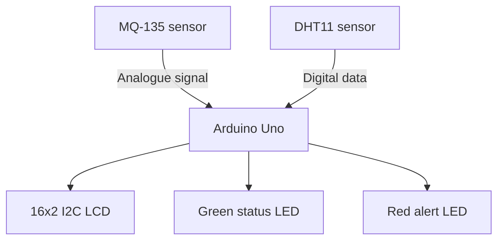

# IoT-Based Smart Helmet for Miners' Safety

**Academic prototype | Arduino Uno | MQ-135 | DHT11 | 16x2 I2C LCD | LED alerts**

## Project overview
This project explores a low-cost helmet-mounted monitoring prototype for demonstrating environmental sensing. An Arduino Uno reads an MQ-135 gas-sensor module and a DHT11 temperature/humidity sensor, displays readings on a 16x2 I2C LCD, and operates LED indicators according to a configurable experimental threshold.

> **Safety notice:** This is an academic prototype, not certified mining-safety equipment. MQ-135 is a broad air-quality/gas sensor and cannot identify or accurately quantify every hazardous gas without suitable calibration and validation. Do not use this prototype to make real mine-entry, evacuation, or worker-safety decisions.

## Objectives
- Read the analogue output of an MQ-135 module.
- Measure temperature and humidity using DHT11.
- Display readings on an I2C LCD.
- Demonstrate LED status indication against an adjustable test threshold.
- Document the hardware, firmware, tests, and limitations.

## Hardware
| Component | Purpose |
|---|---|
| Arduino Uno | Main controller |
| MQ-135 module | Analogue air-quality/gas-sensor response |
| DHT11 | Temperature and humidity measurement |
| 16x2 LCD with I2C backpack | Readout |
| LEDs with current-limiting resistors | Visual status indication |
| Breadboard, wires, suitable power supply | Prototype connections |

## Example pin assignment — verify against your actual build
| Module signal | Arduino Uno pin |
|---|---|
| MQ-135 AO | A0 |
| DHT11 DATA | D2 |
| LCD SDA | A4 |
| LCD SCL | A5 |
| Green LED anode (through resistor) | D9 |
| Red LED anode (through resistor) | D8 |
| All module grounds | GND |
| Module supply | As specified by each module |

The pin assignment above is a **proposed starting configuration**, not a confirmed record of your physical wiring. Check your circuit before connecting power. Use a suitable current-limiting resistor for each LED. Check the voltage requirements of each module and the LCD backpack.

## Software
- Arduino IDE
- Adafruit DHT sensor library
- Adafruit Unified Sensor library (dependency for Adafruit DHT)
- A compatible `LiquidCrystal_I2C` library

The exact LCD library/API can vary by library version. If compilation fails, check the library's examples and adjust the LCD initialization accordingly.

## Block diagram


## Firmware
See [`Code/Smart_Helmet.ino`](Code/Smart_Helmet.ino).

The example firmware:
1. Reads the MQ-135 analogue output.
2. Reads DHT11 temperature and humidity.
3. Displays the values on the LCD.
4. Compares the raw MQ-135 ADC reading with a configurable **demonstration threshold** to switch the LEDs.

**Important:** The default threshold in the sketch is only a placeholder for bench testing. It is not a certified exposure limit, gas concentration, or safety threshold. Determine and document an appropriate experimental threshold only after reviewing the sensor module documentation and conducting controlled testing. Do not describe raw ADC values as ppm.

## Repository structure
```text
IoT-Smart-Helmet-Miners-Safety/
├── README.md
├── Code/
│   └── Smart_Helmet.ino
├── Circuit-Diagram/
│   └── CONNECTIONS.md
├── Documentation/
│   ├── COMPONENTS.md
│   └── TEST-PLAN.md
├── Images/
│   └── README.md
└── Results/
    └── RESULTS-TEMPLATE.md
```

## Testing and results
Record actual test observations in [`Results/RESULTS-TEMPLATE.md`](Results/RESULTS-TEMPLATE.md). Do not add invented readings or claim validated performance without evidence.

## My contribution
Update this section to accurately reflect your own work:
- Hardware assembly and integration
- Arduino programming and sensor interfacing
- LCD display integration
- LED status indication
- Testing, troubleshooting, and documentation

## Team
- Team size: 2
- Author: Kathir Kamalesh N

## Limitations
- MQ-135 requires appropriate warm-up, calibration, and interpretation.
- Its response is affected by multiple gases and environmental conditions.
- DHT11 has limited accuracy and response capability compared with higher-grade sensors.
- This prototype does not provide certified gas-specific alarms, wireless remote monitoring, or a safety-rated alert system.

## Future improvements
- Calibrate and validate sensor response using appropriate reference equipment.
- Add a documented wireless monitoring method, if implemented.
- Add GPS/location reporting, if implemented.
- Improve enclosure, power management, and sensor placement.
- Conduct repeatable tests and document limitations.

## Disclaimer
This repository documents an educational engineering prototype. It is not a substitute for approved industrial gas detectors, mine safety procedures, or certified personal protective equipment.
